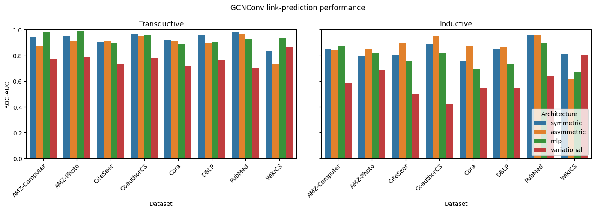

# Asymmetric Graph Autoencoder Link Prediction
This project experimentally evaluates the performance of asymmetric graph autoencoder model for link prediction on common benchmark datasets using both transductive (random-edge-sampling) and inductive (cold-start) settings. It provides both a CLI for quickly running experiments and an API to allow other researchers to integrate the asymmetric model into their own research.


[**Asymmetric model**](#what-is-asymmetric-graph-autoencoder)
| [**CLI Usage**](#running-an-experiment)
| [**API Usage**](#api-overview)

## What is Asymmetric Graph Autoencoder?

The asymmetric decoder combines latent source embeddings with reduced target-node features, while the baselines provide inner product, learned symmetric, probabilistic, and feature-only alternatives. The asymmetric model learns latent representation $Z \in R^{n \times n}$, such that:

$$Z.X_{reduced}^{T} = \hat{A}$$

where $\hat{A}$ is the reconstructed adjacency matrix and $X_{reduced}$ is the dimensionality-reduced feature matrix.




## Running an experiment

Run an experiment with a supported dataset:

```bash
python main.py cora out/results.csv
```

When `--model-type` is omitted, the script runs every registered architecture on the same splits. The six current architectures produce twelve result rows under one run ID after evaluation on both test settings. The feature-cosine baseline is evaluated directly without training.

For trainable architectures, each result row records
`training_time_seconds`, the total wall-clock time spent across all requested
training epochs. The transductive and inductive rows share the same value
because they are evaluated from the same trained model. Non-trainable baselines
leave this field empty.

Add `--verbose` to show dataset preparation, architecture progress, epoch progress, and live loss components:

```bash
python main.py cora out/results.csv --verbose
```

Common options include:

```bash
python main.py citeseer out/results.csv \
  --conv-layer-type GATv2Conv \
  --gatv2-kwargs '{"heads": 2, "concat": false, "dropout": 0.1}' \
  --hidden-channels 128 \
  --out-channels 64 \
  --reduction-method pca \
  --decoder-hidden-channels 64 \
  --decoder-dropout 0.2 \
  --kl-weight 1.0 \
  --learning-rate 0.01 \
  --weight-decay 0.0 \
  --query-size 10 \
  --validation-query-size 10 \
  --train-ratio 0.8 \
  --epochs 100 \
  --selection-metric roc_auc \
  --early-stopping-patience 20 \
  --early-stopping-min-delta 0.001 \
  --seed 42 \
  --device cpu
```

Use `--query-fraction` instead of `--query-size` to select a fraction of
eligible, non-isolated nodes. The two options are mutually exclusive; when
both are omitted, the CLI selects 10 query nodes.

Validation uses a disjoint set of cold-start query nodes. Its size defaults to
the resolved test-query size; use `--validation-query-size` or
`--validation-query-fraction` to override it. Both query populations are
excluded from feature-reducer fitting and from the training topology.

Trainable models run for the full requested epoch budget. After every epoch,
the model is evaluated on the semi-inductive validation split, and the best
checkpoint is restored before either test split is evaluated. Checkpoints use
ROC-AUC by default; `--selection-metric average_precision` selects by average
precision instead.

GATv2 constructor options can be supplied as a JSON object with
`--gatv2-kwargs`. Result rows retain these options in `extra_fields` alongside
the reducer, learning rate, device, query-selection configuration, and any
architecture-specific decoder, VGAE, DEAL, or regularization settings.

Early stopping is disabled unless `--early-stopping-patience` is supplied.
When enabled, training stops after that many consecutive epochs without an
improvement greater than `--early-stopping-min-delta`. The configured epoch
count remains the maximum budget, and the best checkpoint is restored in all
cases. Logged training time includes training, validation, and checkpoint
selection.

Repeat `--seed` to run paired repetitions in one invocation:

```bash
python main.py cora out/results.csv --seed 1 --seed 2 --seed 3
```

Alternatively, `--num-seeds 10` runs seeds 0 through 9. All rows from the
invocation share a `run_id`; repetitions of the same model and hyperparameter
configuration share a stable `configuration_id`. Data splits and evaluation
negatives are generated once per seed and reused across architectures.

Available model types are `symmetric`, `asymmetric`, `mlp`, `variational`, `deal`, and `feature-cosine`. Repeat `--model-type` to choose several explicitly:

```bash
python main.py cora \
  --model-type mlp \
  --model-type variational
```

Supported datasets are Cora, CiteSeer, PubMed, Amazon Photo, Amazon Computers, Coauthor CS, DBLP, WikiCS, and Deezer Europe. Supported convolution layers are `GCNConv`, `GraphConv`, `SAGEConv`, and `GATv2Conv`. Run `python main.py --help` for the complete option list. Newly registered architectures will automatically become available to the CLI.

For example, run the Amazon Photo benchmark with:

```bash
python main.py amazon-photo out/results.csv --verbose
```

## API overview

### Dataset loading

`datasets.load_dataset()` loads a supported benchmark, optionally normalizes its features, moves it to a device, and attaches dataset metadata:

```python
from datasets import load_dataset

data = load_dataset("cora", root="data", device="cpu")
```

`datasets.available_datasets()` returns the normalized names accepted by the loader.

### Features and graph splits

`utils.calculate_reduced_features()` fits a registered feature reducer and stores the transformed features in `data.x_reduced`. Pass a node mask to fit without exposing inductive query features:

```python
import torch

from utils import (
    calculate_reduced_features,
    generate_comparable_splits,
    select_query_nodes,
)

query = select_query_nodes(data, query_size=3, seed=42)
fit_mask = torch.ones(data.num_nodes, dtype=torch.bool)
fit_mask[query] = False
calculate_reduced_features(data, dim=64, fit_nodes=fit_mask)
train, val, test_transductive, test_inductive = generate_comparable_splits(
    data,
    query=query,
    train_ratio=0.8,
)
```

Available reduction methods are `pca`, `truncated-svd`, and
`sparse-random-projection`. For example:

```bash
python main.py coauthor-cs out/results.csv \
  --model-type asymmetric \
  --reduction-method truncated-svd
```

`select_query_nodes()` performs deterministic automatic selection while ensuring
that every query retains at least one visible neighbor. Both split functions can
also select queries directly by accepting `query_size` or `query_fraction` with
a `seed`. `generate_comparable_splits()` creates transductive and inductive test
sets with matching message-passing graphs and equal numbers of labeled edges.
`utils.inductive_split()` is available when only a cold-start split is needed.

### Link-prediction models

The model classes are:

- `GAE_Model`: inner-product symmetric graph autoencoder.
- `AGAE_Model`: asymmetric latent-to-feature decoder.
- `MLP_GAE_Model`: learned symmetric MLP edge decoder.
- `VGAE_Model`: variational encoder with inner-product decoding and KL regularization.
- `DEALModel`: aligned structural-identity and attribute encoders for inductive prediction.
- `FeatureCosineModel`: non-trainable cosine similarity between endpoint features.

`link_prediction.LinkPrediction` provides the shared training and inference interface:

```python
from link_prediction import LinkPrediction

predictor = LinkPrediction(
    train,
    model_type="asymmetric",
    conv_layer_type="SAGEConv",
    hidden_channels=128,
    out_channels=64,
)

for _ in range(100):
    loss = predictor.train()

probabilities = predictor.test(test_inductive)
```

Configure the MLP and variational baselines with `decoder_hidden_channels`, `decoder_dropout`, and `kl_weight`:

```python
mlp = LinkPrediction(
    train,
    model_type="mlp",
    decoder_hidden_channels=64,
    decoder_dropout=0.2,
)
vgae = LinkPrediction(train, model_type="variational", kl_weight=1.0)
```

AGAE supports `none`, `latent-l2`, `mse-alignment`, `cosine-alignment`, and
`graph-smoothness` regularization. Repeat `--agae-regularization` to compare
several methods on the same graph splits and negative samples:

```bash
python main.py cora out/regularization.csv \
  --model-type asymmetric \
  --agae-regularization none \
  --agae-regularization latent-l2 \
  --agae-regularization cosine-alignment \
  --regularization-strength 0.001
```

Use `--weight-decay` to evaluate Adam weight decay separately or in
combination with an explicit AGAE penalty. Regularization settings are stored
in dedicated result columns.

DEAL loss weights use `theta_ss`, `theta_aa`, and `theta_sa`; inference weights use `lambda_ss`, `lambda_aa`, and `lambda_sa`. The CLI exposes these as `--deal-theta-*` and `--deal-lambda-*`, along with similarity scale and margin options.

GATv2-specific options can be passed directly or through `gatv2_kwargs`:

```python
predictor = LinkPrediction(
    train,
    conv_layer_type="GATv2Conv",
    heads=4,
    dropout=0.2,
)
```

### Result logging

`experiment_logging.ExperimentResult` validates experiment metadata and metrics. `CSVResultLogger` appends results to a stable CSV schema; rows written by the same logger share a run ID:

```python
from experiment_logging import CSVResultLogger, ExperimentResult

logger = CSVResultLogger("out/results.csv")
logger.log(ExperimentResult(...))
logger.reset_run_id()  # Start a new experiment group.
```
